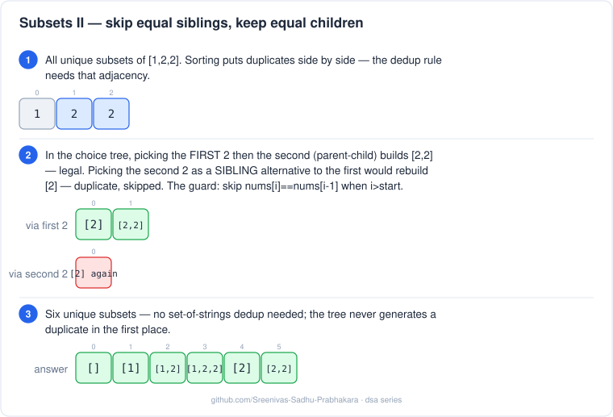

# Subsets II (No Duplicate Subsets)

> Striver SDE Sheet 050 · Day 9 Recursion — sort, then skip equal values at the same recursion depth; duplicates never get generated at all. Go, stdlib only, tested.

## Problem

Generate every unique subset of an array that may contain duplicate values. `[1,2,2]` has six unique subsets, not eight — `{2}` and `{1,2}` must each appear once however many 2s could produce them.

## Approach

Sort first so equal values are adjacent, then backtrack with a start index, recording the current subset at every node (not just leaves). The single dedupe rule: inside one loop level, skip an element equal to its left neighbor (`i > start && a[i] == a[i-1]`). Choosing the *second* 2 where the first was available would rebuild an identical subtree. The guard compares against `start`, not merely `i-1` — equal values stacked *vertically* (take 2, then take the next 2) are legitimate; only *horizontal* repeats at one depth are pruned. Prevention at the source beats generating everything and deduplicating through a set.

**Complexity:** O(2ⁿ · n) worst case (output bound), O(n) depth.

## Visual walkthrough

Read the picture top to bottom — each numbered frame is one moment of the algorithm
running on this repo's test example.

## Run

    go test ./...   # verify
    go run .        # demo

---

One of 191 repos solving Striver's SDE Sheet in Go — stdlib only, one problem per repo, every solution tested. Browse the set: [`dsa-*` repos](https://github.com/Sreenivas-Sadhu-Prabhakara?tab=repositories&q=dsa-&type=source).
